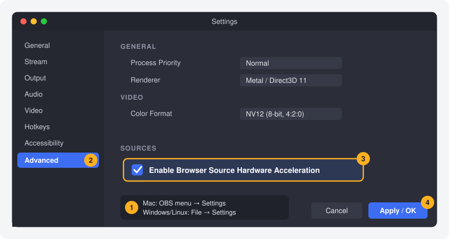
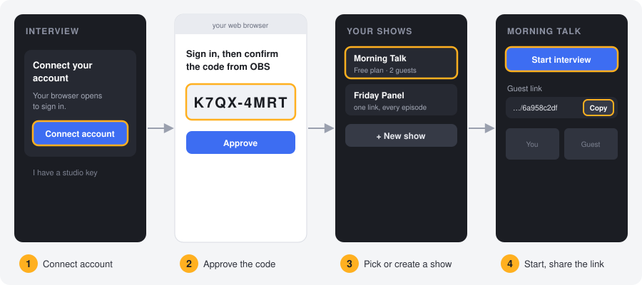

# ISOStream Interview Mode: remote guests in OBS

Bring up to **8 remote guests** into OBS Studio with **one link per show**. Guests join from their
browser (no app, no account). Each person arrives in OBS as their own camera and audio source. An
active-speaker director switches shots for you.

---

## Quick start (about 5 minutes)

1. [Download](#1-download) the file for your computer.
2. [Install the plugin](#2-install-the-obs-plugin) into OBS.
3. [Turn on Browser Source Hardware Acceleration](#3-turn-on-browser-source-hardware-acceleration).
4. [Connect your account and start an interview](#4-connect-and-start-an-interview).

### 1. Download

Open the [**Releases**](../../releases/latest) page and download the installer for your computer:

| Your computer | Download |
|---|---|
| Mac (Apple Silicon or Intel) | `isostream-interview-macos.pkg` |
| Windows 10 or 11 (64-bit) | `isostream-interview-windows-x64-setup.exe` |
| Linux (x86-64) | `isostream-interview-linux-x64.tar.gz` (no plugin yet: see [Linux](#linux)) |

### 2. Install the OBS plugin

**Requires:** OBS Studio 30 or newer. **Quit OBS first.**

**Windows**
1. Double-click `isostream-interview-windows-x64-setup.exe`.
2. If Windows shows "Windows protected your PC", click **More info → Run anyway**.
   (The installer isn't code-signed yet, so Windows doesn't recognise the publisher.)
3. Click **Next**, then **Install**, then **Finish**.

**Mac**
1. Double-click `isostream-interview-macos.pkg`.
2. If macOS says it can't open the installer, right-click it (or Control-click) and choose **Open**,
   then **Open** again. You can also allow it in **System Settings → Privacy & Security**.
3. Click **Continue**, then **Install**.

Then open OBS. The **Interview** panel appears on the right. If you don't see it, use
**Tools → ISOStream Interview → Show Interview dock**.

To remove it later: on Windows, **Settings → Apps → ISOStream Interview Mode → Uninstall**. On a Mac,
delete `isostream-interview.plugin` from `~/Library/Application Support/obs-studio/plugins`.

### 3. Turn on Browser Source Hardware Acceleration

Guest video plays inside OBS browser sources. With hardware acceleration **on**, your graphics card
decodes the video. Guests then look smooth, and OBS stays light on the processor. With it **off**,
expect choppy video and high CPU use.

1. Open **Settings**:
   - **Mac:** OBS menu → **Settings** (or **⌘,**)
   - **Windows / Linux:** **File → Settings**
2. Click **Advanced** in the list on the left.
3. Scroll to **Sources** and tick **Enable Browser Source Hardware Acceleration**.
4. Click **OK**, then **quit and reopen OBS**. The setting only takes effect after a restart.

> Is the option missing or greyed out? Your OBS was built without browser support. Install OBS from
> [obsproject.com](https://obsproject.com) instead.

### 4. Connect and start an interview

1. In the **Interview** panel, click **Connect account**. Your normal web browser opens.
2. Sign in with Google or email, then check that the code matches the one in OBS. Click **Approve**.
   The panel connects by itself within a few seconds.
3. Pick a show, or click **New show**. Each show keeps **one permanent guest link**, so you can send
   the same link every episode.
4. Click **Start interview**, then **Copy** the guest link and send it to your guests.
   - Guests wait in a waiting room until you click **Bring on** on their camera tile.
   - Click **+** on a tile to place that person in your current scene. If the scene has a vertical
     twin, the vertical version is filled too.
   - When you finish, click **End interview**. Every guest is removed and nothing keeps running.

**Room connection settings.** All of these are in OBS under **Tools → ISOStream Interview**:

| Setting | When to change it |
|---|---|
| **Server address…** | Only if you host your own ISOStream Interview Mode server. Enter its `https://` address. Leave it empty to use the default hosted service. |
| **Host key…** | Only if you were given a studio key instead of an account. Paste it here or under *I have a studio key* in the panel. |
| **Back to my shows** | Return to the show list. |
| **Reload Interview dock** | Use if the panel looks stuck after a network drop. |

**Plans.** Every plan has every feature. The **Free** plan fits 2 guests at the same time, for 60 minutes a
month (up to 30 per interview), so you can test everything. **Creator** fits 4 guests and **Studio Pro** fits 8,
both with no time limit. To change plans, click **Upgrade** in the panel.

---

## Linux

There's no Linux plugin build yet. The Linux download has the **ISOStream bridge**, a small program
that lets the ISOStream control room switch your OBS scenes over OBS's built-in WebSocket.

1. In OBS, go to **Tools → WebSocket Server Settings**. Tick **Enable WebSocket server**, then click
   **Show Connect Info** and note the **password**.
2. Unpack the download. Rename `settings.env.example` to `.env` (same folder as the program), open it
   in a text editor and put the OBS password after `OBS_WEBSOCKET_PASSWORD=`.
3. In a terminal, run `./isostream-bridge` and keep it open during the show.

Also turn on [Browser Source Hardware Acceleration](#3-turn-on-browser-source-hardware-acceleration).

---

## Troubleshooting

| Problem | Fix |
|---|---|
| No **Interview** panel | **Tools → ISOStream Interview → Show Interview dock**. Still nothing? Make sure OBS is version 30 or newer, then run the installer again with OBS closed. |
| Guest video is choppy, or OBS uses a lot of CPU | Turn on hardware acceleration (step 3) and restart OBS. |
| Panel says it can't reach the server | Check your internet connection, then **Tools → ISOStream Interview → Reload Interview dock**. |
| "Connect account" never finishes | The code expires after 10 minutes. Click **Connect account** again and approve the new code. |
| A guest can't be heard | Look at their tile's meter. If it is grey, the guest is muted: click their mic icon to ask them to unmute. |
| Linux bridge never says `connected` | The WebSocket server is off in OBS, or the password in `.env` is wrong. |

Each release lists SHA-256 checksums, so you can check that your download is complete.
